<p align="center">
  
</p>

# CapScan

**Where to put stitching capacitors across plane splits, for KiCad 9 and 10.**

CapScan is a KiCad PCB editor plugin. Click its button and it reads the open board through
KiCad's IPC API, finds every signal whose return current meets a break in its reference
plane, and tells you how many stitching capacitors are needed, where (X / Y and board side),
what value and voltage rating, and which two plane nets each one bridges.

The only setup is choosing which nets to scan. Tick **Scan all signal nets**, or pick nets
from the list (a filter box finds `USB`, `DDR*` and so on). Every net scanned is taken to be
a fast digital signal (100 ps edges on 50 Ω traces) unless you give it its own edge rate and
impedance, and every default leans towards more stitching rather than less: a basic utility
that keeps every signal's return path next to it.

What changed in each release is in [docs/CHANGELOG.md](docs/CHANGELOG.md).


## What it finds

| Problem | What CapScan says |
|---|---|
| A trace crossing a **split** between two plane nets on its reference layer | A stitching capacitor between the two nets within 2.5 mm (100 mil) of the crossing |
| A **via** moving a signal onto a reference plane of **another net** (GND → 3V3) | A stitching capacitor between them within 1.27 mm of the via |
| A via moving a signal onto **another plane of the same net** (GND1 → GND8) | A return via of that net within 1.27 mm, unless one is already there |
| A trace over **no plane at all** (a void, a cutout, past a plane's edge) | Flagged: no capacitor helps; reroute or fill the plane |
| A return that would flow through a **decoupling capacitor** (one next to an IC pin) | Flagged, and given a dedicated stitching capacitor of its own |

Existing capacitors between two plane nets are credited when they stand on their own. A
capacitor next to an IC's pin on either of its nets is decoupling that IC, and is never
counted as a stitching capacitor.

## What you get

* **3D Heat Map**: each reference plane with the density of return-path breaks rendered on
  it: splits, voids, vias that need a stitching cap, and vias still missing a return via.
  Hotter means more breaks in a small area. Tick boxes pick which kinds of break add heat.
  Signals are colored by heat and the new capacitors are drawn on the board.
* **2D Placement**: one reference layer at a time. Plane nets are filled, crossings are
  marked, and the capacitors and return vias are labeled. Click one to find it in the tables.
* **Tables**:
  * Stitching caps: value, dielectric, package, voltage rating, nets, X / Y, side, angle,
    and the signals each one serves.
  * Signals: every signal crossing a split, with its routing layers and reference layers.
  * Crossings, via transitions, and the existing capacitor audit.
* **Markers on the board**: *Place markers* draws each capacitor, return via and void on
  User.Comments in one undo step. *Clear markers* removes them again.
* **Adding the parts**: *Add to board…* puts the capacitors on the board in KiCad, each pad
  with a via to its plane, and adds the return vias. It picks the footprint (one the board
  already uses for that package, else KiCad's library one), the via size and type, and the
  first reference designator, and any of them can be changed. DRC runs before and after,
  and anything that breaks it is taken off again. *Add all* is one undo step; *Step
  through* shows each part in KiCad and asks to keep it. The parts are ordinary footprints:
  add them to the schematic.
* **Reports**: one self-contained HTML file with an interactive 3D view, or a PDF with the 3D
  view attached and a fillable notes box.

Double-click any row to find it on the map and select that net in KiCad.

| 3D heat map, close up | 2D placement |
|---|---|
| 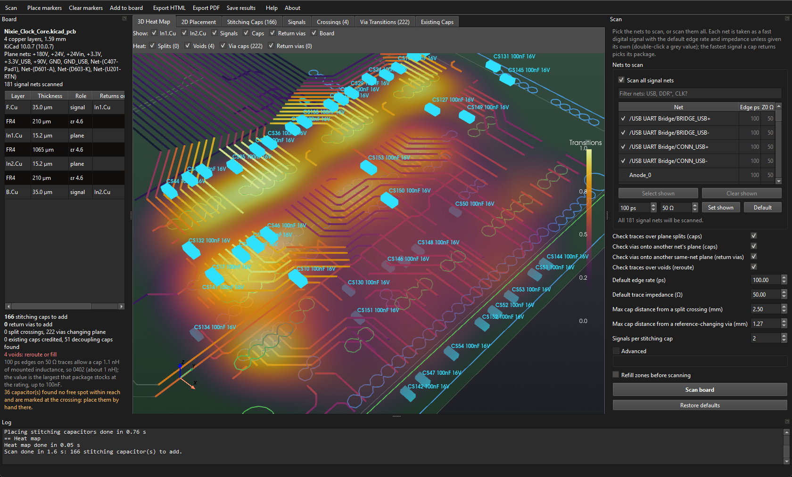 | 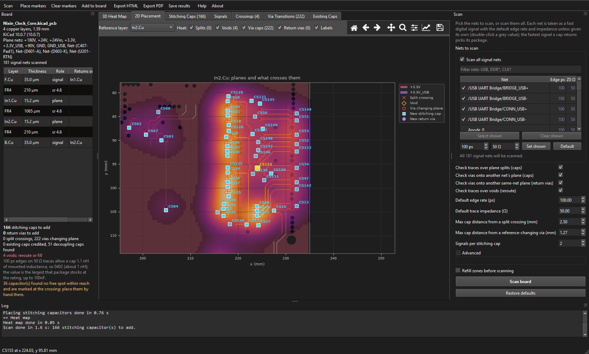 |

| Stitching caps | Via transitions |
|---|---|
| 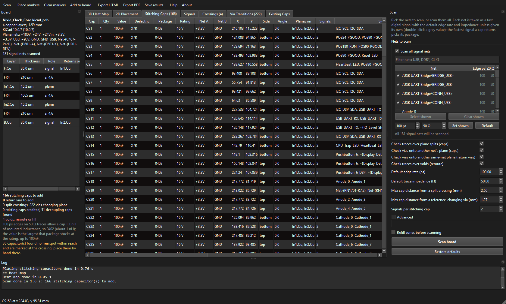 | 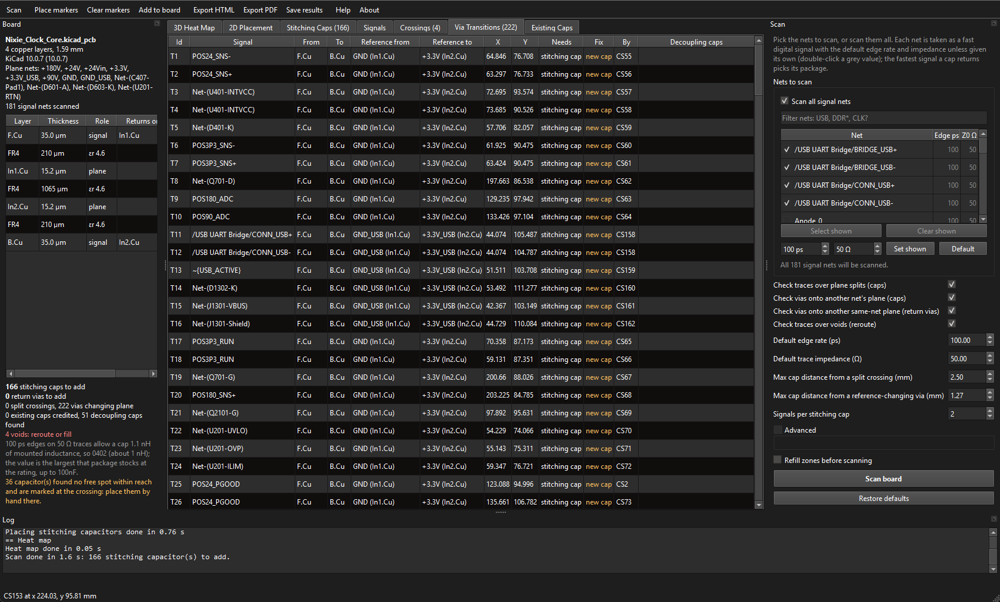 |

| Signals | Existing caps |
|---|---|
| 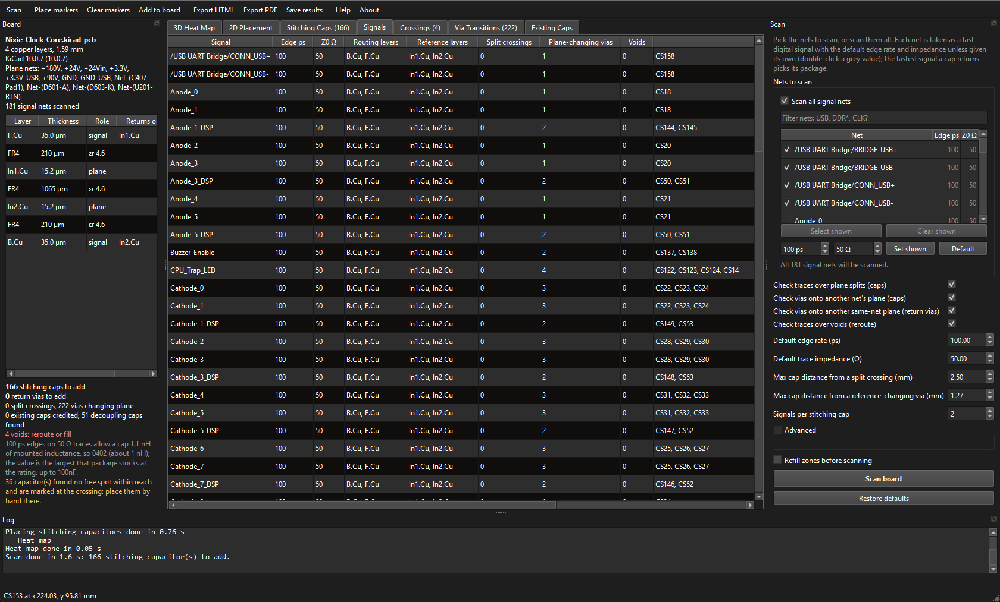 | 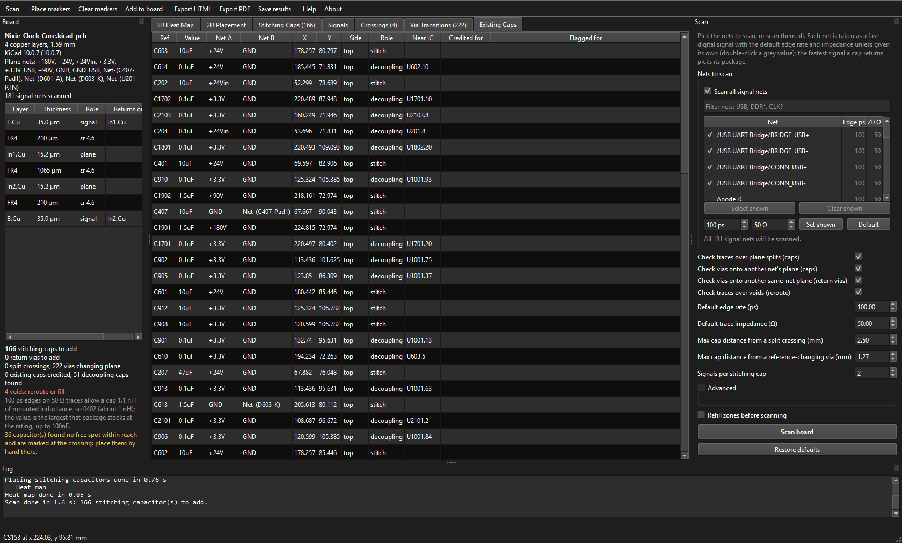 |

| HTML report | Its interactive 3D view |
|---|---|
| 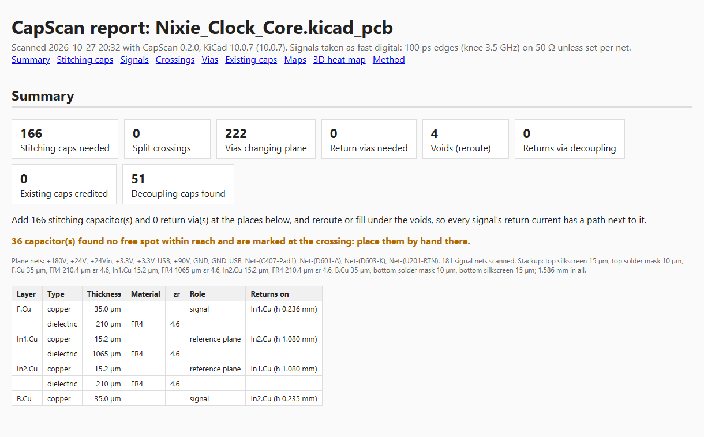 | 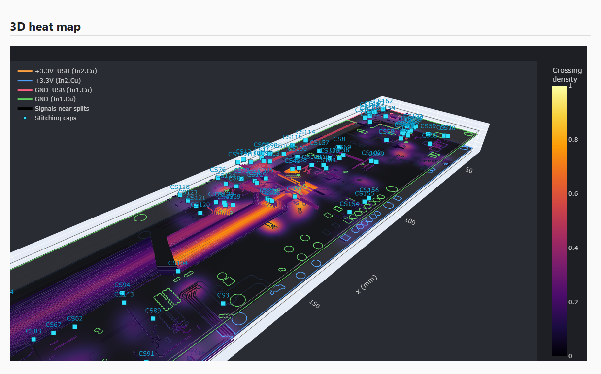 |

## Install

### Requirements

* **KiCad 9.0 or later**, with **Preferences → Plugins → Enable KiCad API** checked.
  Before KiCad 9.0.3, KiCad cannot say which layers a plated pad has copper on, so pads are
  kept on every layer (CapScan says so in its log).
* **Python 3.10 to 3.13**, the one KiCad runs plugins with. On Windows that is KiCad's own
  Python; on macOS, select a Python 3.12 in *Preferences → Plugins* (KiCad's bundled 3.9 is
  too old).

### Steps

1. Link (or copy) this repo into KiCad's plugins folder as `CapScan`. For KiCad 9, put
   `9.0` in place of `10.0`:

   ```powershell
   $plug = "$([Environment]::GetFolderPath('MyDocuments'))\KiCad\10.0\plugins"
   New-Item -ItemType Junction -Path "$plug\CapScan" -Target "<path to this repo>"
   ```

   ```sh
   ln -s "<path to this repo>" ~/Documents/KiCad/10.0/plugins/CapScan        # macOS
   ln -s "<path to this repo>" ~/.local/share/kicad/10.0/plugins/CapScan     # Linux
   ```

   Or unzip `CapScan-<version>.zip` from the
   [latest release](https://github.com/drewsum/Kicad-Cap-Scan/releases/latest) there.

2. Restart the PCB editor. KiCad builds the plugin's Python environment from
   `requirements.txt` in the background, which takes a few minutes the first time. The
   **CapScan** toolbar button appears once it is ready.

## Using it

1. Open the board in the PCB editor and click **CapScan**. It reads the board and shows it
   at once, in 3D and 2D: the stackup, every plane, and the signal routing, in KiCad's
   layer colors, with the nets you pick drawn solid and the rest faint. It also lists the board's signal nets (planes and supplies are left out) under *Nets to scan*. Tick **Scan all
   signal nets**, or filter the list and tick the nets you want (*Select shown* ticks every
   net the filter shows), then click **Scan board**. Each net's **Edge ps** and **Z0 Ω**
   show the defaults in grey. Double-click one to give that net its own, or filter to a
   bus, enter an edge rate and impedance under the list and click *Set shown*. *Default*
   puts the nets shown back on the defaults. The nets you pick and their speeds are
   remembered for that board; nothing is scanned until you click **Scan board**.
   The scan reads the zone fills as they are, and the fills decide where the planes are:
   tick *Refill zones before scanning* (or press B in KiCad) if they may be stale.

   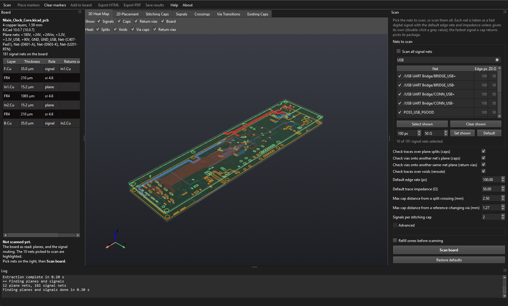

   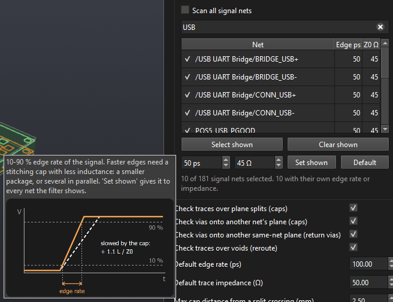
2. Read the summary on the left. The **Stitching Caps** tab is the list of parts to add.
3. Click **Place markers** to see the spots in the PCB editor, then **Export PDF** or
   **Export HTML** for the report.
4. Or click **Add to board…** to put the parts and vias on the board (see
   [Adding the parts](#adding-the-parts)), then add the capacitors to the schematic under
   the references they were given.

### Adding the parts

* **Footprint**: for each package, the capacitor footprint the board already uses most,
  else KiCad's `Capacitor_SMD` one; *Browse…* takes any `.kicad_mod` file.
* **Vias**: the size most used on the plane nets, from the board's predefined sizes and net
  classes. KiCad 9 and 10 have no switch for blind, buried or microvias, so CapScan offers
  each type only if the board already uses it and the custom rules do not disallow it; a
  microvia when the plane is next to the cap's side, else a blind via, else a through via.
* **References**: the first stitching cap's reference, `C` and the next free number unless
  set (say `C500`); the rest count up from it, skipping any already on the board.
* **Design rules** are read from the project (`.kicad_pro`, `.kicad_dru`): close Board
  Setup with OK first. A via only goes where it keeps the clearance from every other net's
  copper on every layer it passes through. DRC (`kicad-cli`, on a copy of the board as it is
  in the editor) runs before and after; whatever a new violation names is taken off. A
  step-through runs it once before the first part and once after the last, not per part.
* A cap on the bottom needs KiCad 10.0.6 or later (to flip it), unless the board already
  has a bottom-side footprint to copy.

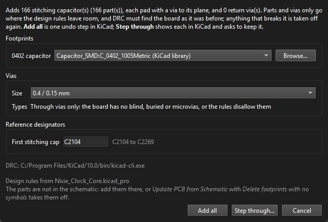

Each kind of break has its own switch at the top of the *Scan* panel. For example, turn
off *Check vias onto another net's plane* to get capacitors for split crossings only. A
check that is off is not looked for at all, and the summary and reports say it was not
checked. The panel also has the few other settings worth changing. *Advanced* holds every
rule, each explained in [docs/research.md](docs/research.md). Every setting has a tooltip,
and those about something easier seen than read show a drawing. Results are also saved
beside the board as `<board>.capscan.json.gz`.

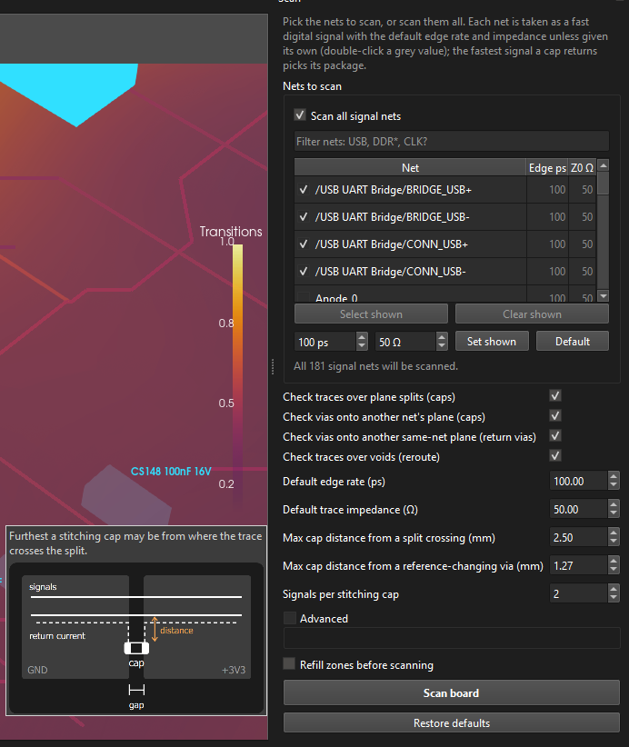

## How it works

1. **Planes and signals.** A net is a plane net if its zone fills cover 2 % of the board on
   some layer, or if it is named like a supply or ground and has any fill. A net is also a
   supply, whatever its name, when it is poured on two or more layers or has an array of four
   or more vias (a regulator output the schematic left as `Net-(U2-OUT)`). Every other routed
   net is a signal. Differential pairs (`_P`/`_N`, `+`/`-`) count as one return path.
2. **Reference layers.** A copper layer is a reference layer if plane nets cover 20 % of it.
   Each signal layer returns its current on the nearest reference layer above it and the
   nearest below. Heights come from the board's stackup.
3. **Crossings.** Each signal is walked along its centerline in 50 µm steps over each of
   its reference layers:
   * plane net A, then a gap, then plane net B is a split;
   * a long stretch over nothing is a void;
   * a void on one side of a stripline whose other plane is solid is noted, not flagged.
4. **Vias.** For each signal via and through-hole pin, CapScan reads the layers the signal
   actually enters and leaves on. It then compares the plane nets round the via on those
   layers' reference planes.
5. **Placement.** Existing stand-alone capacitors are credited first. Each new capacitor is
   placed greedily where it reaches the most uncovered signals, two at most. It goes on the
   board side nearer both planes, clear of other copper and parts, with its pads across the
   split.
6. **Part.** Picked for you; there is no package to set. The edge rate and impedance of
   the fastest signal a cap returns (100 ps on 50 Ω unless set for that net) set how much
   mounted inductance it may have. CapScan takes the largest of
   0402 / 0603 / 0805 within that budget, or several 0402s in parallel for faster edges. The
   value is the largest X7R part that package stocks at the voltage rating, up to 100 nF.
   The voltage rating is at least twice the voltage between the two nets as their names
   give it (3V3, 1V8, +5V, VBUS), and never below 16 V. Nets whose voltage the name does not
   give get a 50 V rating. See [docs/research.md](docs/research.md#value-and-package).

## Development

```sh
python -m venv .venv
.venv/Scripts/pip install -r requirements.txt -r requirements-dev.txt   # bin/ on Linux and macOS
.venv/Scripts/python -m pytest
.venv/Scripts/python -m ruff check .
```

`python -m capscan --dump board.json.gz` saves the board open in KiCad as a snapshot.
`python -m capscan --scan board.json.gz --html out.html` scans a snapshot with no KiCad.
`python -m capscan board.json.gz` opens the window on one.

| Folder | What is in it |
|---|---|
| `capscan/kicad/` | Everything that talks to KiCad: extraction (with fallbacks for each KiCad 9 / 10 release), the markers, and adding the parts (design rules, footprints, DRC) |
| `capscan/model/`, `capscan/geometry/` | The board snapshot and its geometry, shared with [KiPI](https://github.com/drewsum/KiPI) |
| `capscan/analysis/` | The scan: rules, references, crossings, transitions, existing caps, placement, values, heat map |
| `capscan/report/` | The 2D map, the 3D scene, and the HTML / PDF reports |
| `capscan/gui/` | The window (Qt, pyvista, matplotlib) |
| `resources/` | The icons, and `capscan.gif`, the animated logo (`tools/make_logo_gif.py` draws it) |
| `docs/images/` | The screenshots in this README; `tools/screenshots.py` takes them again from the board open in KiCad |
| `docs/CHANGELOG.md` | What changed in each release; add a line under **Unreleased** with each change |
| `tests/` | pytest. `tests/helpers/boards.py` builds boards with known answers; `kicad_fake.py` answers like each KiCad release |
| `.github/` | CI; `release.yml` attaches `CapScan-<tag>.zip` to each release; `stats.yml` publishes the clone and download counts the About dialog shows |

Publishing a GitHub release attaches the plugin zip to it (GitHub counts downloads of
attached files only, not of the automatic source archives). The daily **Stats** workflow
writes `stats.json` to the `stats` branch; its clone counts need a `TRAFFIC_TOKEN`
repository secret (a fine-grained token for this repo with Administration: read-only).
Without it the workflow still counts release downloads and warns about the clones.

## License

GPL-3.0-or-later. The extraction, board model, geometry, PDF printing and window
scaffolding come from [KiPI](https://github.com/drewsum/KiPI).
